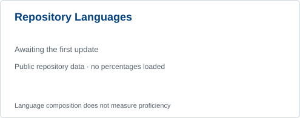

# lian

中国海洋大学 · 计算机科学与技术 · 本科在读。这里整理我参与的科研、竞赛、课程和个人项目。

  <a href="#research">🔵 科研经历</a>  · 
  <a href="#competitions">🟠 竞赛实践</a>  · 
  <a href="#coursework">🟢 课程作品</a>  · 
  <a href="#side-projects">🟣 自由构建</a>

## 🔵 科研经历 · Research

### [UniKT](https://github.com/szhhwh/UniKT) · 知识追踪研究与实验

参与团队知识追踪研究与实验框架开发，开展模型实现、实验复现与评估工作。

#### HDHKT · 异构图与难度感知超图融合的知识追踪方法

**第二作者 · Pattern Recognition**

[HDHKT: Heterogeneous graph and difficulty-aware hypergraph fusion for knowledge tracing](https://www.sciencedirect.com/science/article/pii/S0031320326021898)

- **研究问题：** 如何同时建模学习过程中的异构实体关系，以及题目之间的高阶群组结构。
- **研究方法：** 结合异构图与难度感知超图，通过混合专家（MoE）机制融合不同结构视角的表示，用于知识状态建模与答题表现预测。
- **本人工作：** 参与研究构思、代码实现、实验验证与结果分析、可视化及论文初稿撰写。

[论文 ↗](https://www.sciencedirect.com/science/article/pii/S0031320326021898) · [论文代码 ↗](https://github.com/szhhwh/HDHKT) · [UniKT ↗](https://github.com/szhhwh/UniKT)

### 国家级大学生创新创业训练计划项目（国创）

**基于动态认知建模学习的多模态知识追踪方法研究**

**核心贡献人 · 国家级立项**

- **研究目标：** 面向学生认知状态的动态变化与多模态学习数据融合，研究知识状态建模与个性化学习支持方法。
- **本人工作：** 负责图结构模型的融合应用，以及项目报告的整合撰写。

## 🟠 竞赛实践 · Competitions

### [CUMCM · 全国大学生数学建模竞赛](https://github.com/qiqiqisi/CUMCM)

**2026.09 · 省级三等奖 · 团队项目**

- **选题：** C 题《微网与外部电网电力调控策略》。
- **项目内容：** 围绕光伏预测误差、负荷波动与实时电价，研究微网购电与储能的协同调度；采用混合整数线性规划、随机场景与滚动优化方法。
- **项目材料：** Python 求解代码、实验结果及 LaTeX 论文。团队仓库目前为私有，需相应权限访问。

<!-- 个人分工待确认；获奖等次采用用户提供的“省三”。 -->

## 🟢 课程作品 · Coursework

| 项目 | 简介 | 当前状态 |
| :--- | :--- | :--- |
| [移动软件开发](https://github.com/pxlian/mobile-software-development) | 微信小程序课程实验与作品归档 | 课程归档 |
| [ongoing_ · 未完](https://github.com/pxlian/mobile-software-development/tree/main/project-my%20summer%20holiday) | 生活记录小程序，支持 Moment、Chapter 与共同记录 | 云端验收待完成 |

## 🟣 自由构建 · Side Projects

### [信火追源](https://github.com/pxlian/Xinghuozhuiyuan) · 红色标语数字研学平台

中国海洋大学“信火追源”研习团社会实践的数字化成果，整合标语档案、对比分析、走访记录与互动体验。

- **项目内容：** 全文检索与分类档案、调研路线展示、研究材料阅读，以及 Canvas 策略塔防游戏。
- **使用技术：** HTML / CSS / JavaScript / Canvas。
- **项目归属：** 团队实践作品；各模块功能说明见项目 README。

[在线体验 ↗](https://pxlian.github.io/Xinghuozhuiyuan/) · [源代码 ↗](https://github.com/pxlian/Xinghuozhuiyuan)

---

### GitHub 活动

  
  

统计基于公开数据；语言分布主要反映本人仓库的代码构成，不涵盖全部团队项目，也不代表熟练程度。
